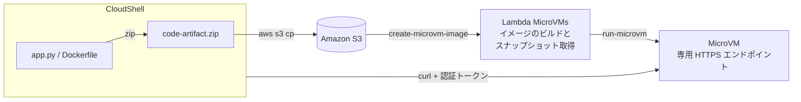

# AWS Lambda MicroVMs ハンズオン

AWS Lambda MicroVMs を初めて使う方向けのハンズオンです。AWS マネジメントコンソールの CloudShell からコマンドで操作し、Flask の Web アプリを MicroVM としてデプロイします。起動、アクセス、一時停止と再開、終了までのライフサイクルを一通り体験します。

## このハンズオンで学べること

- Lambda MicroVMs の基本的な仕組み（イメージ、スナップショット、MicroVM）
- Dockerfile と ZIP を使ったアプリのパッケージング
- MicroVM イメージの作成から MicroVM の起動、アクセスまでの流れ
- ライフサイクルフック（`/ready`、`/run`、`/suspend`、`/resume`、`/terminate`）の役割
- 一時停止（suspend）と再開（resume）で、メモリの状態が保たれること

## 所要時間

約 60 分

## Lambda MicroVMs とは

Lambda MicroVMs は、Firecracker による VM レベルの隔離と、スナップショットからの高速起動を組み合わせたサーバーレスの実行環境です。ユーザーやジョブごとに専用の環境が必要なケース（AI が生成したコードを動かすサンドボックス、オンラインのコード実行環境、マルチテナントの CI など）に向いています。

従来の Lambda 関数（現在の名称は Lambda Event Functions）との主な違いは次のとおりです。

| 観点 | Lambda Event Functions | Lambda MicroVMs |
|---|---|---|
| 起動のきっかけ | S3 や SQS などのイベント | `RunMicrovm` API で明示的に起動 |
| 実行時間 | 1 回の呼び出しで最大 15 分 | 稼働中と一時停止中を合わせて最大 8 時間 |
| 状態 | 呼び出しごとに独立 | メモリとディスクの状態を保ったまま一時停止と再開ができる |
| アクセス方法 | イベントや Invoke API | 専用の HTTPS エンドポイント（認証トークン付き） |
| CPU アーキテクチャ | x86_64 または arm64 | arm64 のみ |

## 全体の構成



ハンズオンの流れは次のとおりです。

1. CloudShell の準備
2. IAM ロールの作成
3. アプリの作成
4. ZIP の作成と S3 へのアップロード
5. MicroVM イメージの作成
6. MicroVM の起動
7. MicroVM へのアクセス
8. 一時停止と再開
9. （任意）2 台目の MicroVM を起動する
10. MicroVM の終了
11. 後片付け

---

## 環境へのアクセス

* 下記の URL をコピーして、ブラウザの新しいタブで開きます。

    - `https://d-9567586b55.awsapps.com/start`

* 講師が URL とユーザー ID やパスワードをご案内します。

* サインインしたら、表示された AWS アカウントを展開し、ロール名のリンクをクリックして AWS マネジメントコンソールを開きます。

* 画面右上のリージョンを、講師が指定したリージョン（例: 米国西部 (オレゴン) `us-west-2`）に切り替えます。

---

## Step 1. CloudShell の準備

### 1-1. CloudShell を起動する

マネジメントコンソールの上部にある CloudShell のアイコン（`>_`）をクリックします。プロンプトが表示されるまで少し待ちます。

> 以降のコマンドは、すべて CloudShell 上で実行します。コマンドはコピーして貼り付けてください。

### 1-2. AWS CLI が Lambda MicroVMs に対応しているか確認する

```bash
aws --version
aws lambda-microvms list-managed-microvm-images
```

ベースイメージの一覧が表示されれば準備完了です。次の手順 1-3 に進んでください。

`Invalid choice` や `argument command: Invalid choice` のようなエラーが表示された場合は、CloudShell の AWS CLI が古いため、次のコマンドで最新版に更新します。

```bash
# AWS CLI v2 の最新版をホームディレクトリにインストールする
cd ~
curl -sS "https://awscli.amazonaws.com/awscli-exe-linux-x86_64.zip" -o awscliv2.zip
unzip -q -o awscliv2.zip
./aws/install --install-dir ~/aws-cli --bin-dir ~/bin --update
export PATH=~/bin:$PATH
rm -rf awscliv2.zip aws

aws --version
aws lambda-microvms list-managed-microvm-images
```

### 1-3. 作業用の変数を設定する

ほかの参加者とリソース名が重ならないように、自分専用の接頭辞（`PREFIX`）を決めます。`user01` の部分は、講師から案内されたユーザー名など、ほかの人と重ならない英小文字と数字に置き換えてください。

```bash
# 自分専用の接頭辞（英小文字と数字のみ）
export PREFIX=user01

# アカウント ID とリージョン（CloudShell のリージョンを使う）
export ACCOUNT=$(aws sts get-caller-identity --query Account --output text)
export REGION=${AWS_REGION:-us-west-2}

# リソース名
export BUCKET=${PREFIX}-microvm-${ACCOUNT}-${REGION}
export IMAGE=${PREFIX}-hello-microvm
export BUILD_ROLE=${PREFIX}-MicroVMBuildRole
export EXEC_ROLE=${PREFIX}-MicroVMExecutionRole
export LOG_GROUP=/aws/lambda-microvms/${IMAGE}

# Lambda が管理するベースイメージ（Amazon Linux 2023）
export BASE_IMAGE_ARN=arn:aws:lambda:${REGION}:aws:microvm-image:al2023-1

env | grep -E '^(PREFIX|ACCOUNT|REGION|BUCKET|IMAGE|BUILD_ROLE|EXEC_ROLE|LOG_GROUP|BASE_IMAGE_ARN)='
```

> CloudShell のセッションが切れると、変数は消えてしまいます。セッションが切れたときは、この手順 1-3 をもう一度実行してください。

### 1-4. 作業ディレクトリと S3 バケットを作成する

```bash
mkdir -p ~/microvm-handson && cd ~/microvm-handson

# アプリの ZIP を置く S3 バケット（イメージと同じリージョンに作る）
aws s3 mb s3://${BUCKET} --region ${REGION}
```

---

## Step 2. IAM ロールの作成

MicroVMs では、次の 2 つの IAM ロールを使います。

| ロール | 使われるタイミング | 主な権限 |
|---|---|---|
| ビルド用ロール（`buildRoleArn`） | イメージのビルド時 | S3 からの ZIP の読み取り、CloudWatch Logs への書き込み |
| 実行用ロール（`executionRoleArn`） | MicroVM の実行時 | CloudWatch Logs への書き込み（アプリから AWS サービスを使う場合はその権限も） |

### 2-1. 信頼ポリシーを作成する

2 つのロールで共通の信頼ポリシーです。`aws:SourceAccount` の条件を付けて、自分のアカウントからの利用に限定しています（混乱した代理問題への対策）。

```bash
cat > trust-policy.json <<EOF
{
  "Version": "2012-10-17",
  "Statement": [
    {
      "Effect": "Allow",
      "Principal": { "Service": "lambda.amazonaws.com" },
      "Action": "sts:AssumeRole",
      "Condition": { "StringEquals": { "aws:SourceAccount": "${ACCOUNT}" } }
    }
  ]
}
EOF
```

### 2-2. ビルド用ロールを作成する

```bash
cat > build-policy.json <<EOF
{
  "Version": "2012-10-17",
  "Statement": [
    {
      "Effect": "Allow",
      "Action": "s3:GetObject",
      "Resource": "arn:aws:s3:::${BUCKET}/*"
    },
    {
      "Effect": "Allow",
      "Action": ["logs:CreateLogGroup", "logs:CreateLogStream", "logs:PutLogEvents"],
      "Resource": "arn:aws:logs:${REGION}:${ACCOUNT}:log-group:/aws/lambda-microvms/*"
    }
  ]
}
EOF

aws iam create-role \
  --role-name ${BUILD_ROLE} \
  --assume-role-policy-document file://trust-policy.json

aws iam put-role-policy \
  --role-name ${BUILD_ROLE} \
  --policy-name build-policy \
  --policy-document file://build-policy.json
```

### 2-3. 実行用ロールを作成する

```bash
cat > exec-policy.json <<EOF
{
  "Version": "2012-10-17",
  "Statement": [
    {
      "Effect": "Allow",
      "Action": ["logs:CreateLogGroup", "logs:CreateLogStream", "logs:PutLogEvents"],
      "Resource": "arn:aws:logs:${REGION}:${ACCOUNT}:log-group:/aws/lambda-microvms/*"
    }
  ]
}
EOF

aws iam create-role \
  --role-name ${EXEC_ROLE} \
  --assume-role-policy-document file://trust-policy.json

aws iam put-role-policy \
  --role-name ${EXEC_ROLE} \
  --policy-name exec-policy \
  --policy-document file://exec-policy.json

# IAM の変更が反映されるまで少し待つ
sleep 10
```

---

## Step 3. アプリの作成

Flask で作った簡単な Web アプリです。ポートを 2 つ使います。

| ポート | 用途 |
|---|---|
| 8080 | アプリ本体。外部からの通信は、デフォルトでこのポートに転送される |
| 9000 | ライフサイクルフック。Lambda が状態の変わり目に呼び出す |

アプリはアクセスされるたびにカウンターを 1 増やします。Step 8 では、このカウンターを使って、一時停止して再開してもメモリの状態が保たれることを確認します。

### 3-1. app.py を作成する

```bash
mkdir -p app && cd app

cat > app.py <<'EOF'
import threading
import time
import uuid

from flask import Flask

# ---- アプリ本体（ポート 8080）----
app = Flask(__name__)

# 状態を保持する変数
state = {
    "instance_id": None,   # MicroVM ごとに固有の ID（/run で生成する）
    "count": 0,            # アクセス回数（一時停止して再開しても残る）
    "resumed": 0,          # 再開した回数
    "booted_at": time.strftime("%Y-%m-%d %H:%M:%S"),  # ビルド時にアプリが起動した時刻
}


@app.get("/")
def root():
    state["count"] += 1
    return {
        "message": "Hello from Lambda MicroVM!",
        "instance_id": state["instance_id"],
        "count": state["count"],
        "resumed": state["resumed"],
        "booted_at": state["booted_at"],
    }


# ---- ライフサイクルフック（ポート 9000）----
hooks = Flask("hooks")
P = "/aws/lambda-microvms/runtime/v1"


@hooks.post(f"{P}/ready")
def ready():
    # ビルド時に呼ばれる。初期化が終わったら 200 を返す（まだなら 503 を返す）
    print("[hook] ready", flush=True)
    return "", 200


@hooks.post(f"{P}/validate")
def validate():
    # ビルド後の動作確認で呼ばれる
    print("[hook] validate", flush=True)
    return "", 200


@hooks.post(f"{P}/run")
def run():
    # MicroVM の起動直後に 1 回だけ呼ばれる。
    # スナップショットは全台で共通なので、MicroVM ごとに固有の値はここで作る
    state["instance_id"] = str(uuid.uuid4())
    print(f"[hook] run instance_id={state['instance_id']}", flush=True)
    return "", 200


@hooks.post(f"{P}/suspend")
def suspend():
    # 一時停止の直前に呼ばれる
    print("[hook] suspend", flush=True)
    return "", 200


@hooks.post(f"{P}/resume")
def resume():
    # 再開の直後に呼ばれる
    state["resumed"] += 1
    print(f"[hook] resume resumed={state['resumed']}", flush=True)
    return "", 200


@hooks.post(f"{P}/terminate")
def terminate():
    # 終了の直前に呼ばれる
    print("[hook] terminate", flush=True)
    return "", 200


if __name__ == "__main__":
    # フック用のサーバーは別のスレッドで動かす。どちらも 0.0.0.0 で待ち受けること
    threading.Thread(
        target=lambda: hooks.run(host="0.0.0.0", port=9000), daemon=True
    ).start()
    app.run(host="0.0.0.0", port=8080)
EOF
```

### 3-2. Dockerfile を作成する

```bash
cat > Dockerfile <<'EOF'
# Lambda が提供する Amazon Linux 2023 のコンテナベースイメージ（arm64 対応）
FROM public.ecr.aws/lambda/microvms:al2023-minimal

RUN dnf install -y python3 python3-pip && dnf clean all
RUN pip3 install --no-cache-dir flask==3.0.3

WORKDIR /app
COPY app.py .

# アプリ用（8080）とフック用（9000）のポートを公開する
EXPOSE 8080 9000

CMD ["python3", "app.py"]
EOF

ls -l
```

> この Dockerfile は、ローカルや CloudShell でビルドする必要はありません。ZIP にして S3 に置くと、Lambda がクラウド上でビルドします。

---

## Step 4. ZIP の作成と S3 へのアップロード

Dockerfile が ZIP のルート（一番上の階層）に来るように作成します。

```bash
zip -j ../code-artifact.zip Dockerfile app.py
cd ..

# 中身を確認する（Dockerfile と app.py がルートにあること）
unzip -l code-artifact.zip

aws s3 cp code-artifact.zip s3://${BUCKET}/${IMAGE}/v1/code-artifact.zip
```

---

## Step 5. MicroVM イメージの作成

`create-microvm-image` を呼ぶと、Lambda が次の順に処理します。

1. S3 から ZIP を取得し、Dockerfile を実行してコンテナイメージを作る
2. `CMD` でアプリを起動する
3. `/ready` フックに問い合わせ、200 が返ったらメモリとディスクのスナップショットを取る
4. スナップショットから起動し、`/validate` フックで動作を確認する

### 5-1. フックの設定ファイルを作成する

```bash
cat > hooks.json <<'EOF'
{
  "port": 9000,
  "microvmImageHooks": {
    "ready": "ENABLED",
    "readyTimeoutInSeconds": 60,
    "validate": "ENABLED",
    "validateTimeoutInSeconds": 30
  },
  "microvmHooks": {
    "run": "ENABLED",
    "runTimeoutInSeconds": 5,
    "resume": "ENABLED",
    "resumeTimeoutInSeconds": 5,
    "suspend": "ENABLED",
    "suspendTimeoutInSeconds": 5,
    "terminate": "ENABLED",
    "terminateTimeoutInSeconds": 5
  }
}
EOF
```

### 5-2. イメージを作成する

ベースラインは 2 GB / 1 vCPU（デフォルト）にします。負荷が高いときは、最大でその 4 倍まで自動で増えます。

```bash
aws lambda-microvms create-microvm-image \
  --name ${IMAGE} \
  --description "Lambda MicroVMs handson (${PREFIX})" \
  --base-image-arn ${BASE_IMAGE_ARN} \
  --build-role-arn arn:aws:iam::${ACCOUNT}:role/${BUILD_ROLE} \
  --code-artifact "{\"uri\":\"s3://${BUCKET}/${IMAGE}/v1/code-artifact.zip\"}" \
  --cpu-configurations '[{"architecture":"ARM_64"}]' \
  --resources '[{"minimumMemoryInMiB":2048}]' \
  --logging "{\"cloudWatch\":{\"logGroup\":\"${LOG_GROUP}\"}}" \
  --hooks file://hooks.json

export IMAGE_ARN=arn:aws:lambda:${REGION}:${ACCOUNT}:microvm-image:${IMAGE}
```

### 5-3. ビルドの完了を待つ

ビルドには数分かかります。次のコマンドは、30 秒ごとに状態を表示します。

```bash
while true; do
  STATE=$(aws lambda-microvms get-microvm-image --image-identifier ${IMAGE_ARN} --query state --output text)
  echo "$(date +%T) image state: ${STATE}"
  case "${STATE}" in
    CREATED|UPDATED) echo "ビルドが完了しました"; break ;;
    *FAILED)         echo "ビルドに失敗しました。トラブルシューティングを参照してください"; break ;;
  esac
  sleep 30
done
```

イメージのバージョンと、アーキテクチャごとのビルドの状況を確認します。

```bash
aws lambda-microvms get-microvm-image --image-identifier ${IMAGE_ARN}

aws lambda-microvms list-microvm-image-builds \
  --image-identifier ${IMAGE_ARN} \
  --image-version 1.0
```

> イメージの状態（`CREATED`）とは別に、バージョンにも状態（`SUCCESSFUL` / `FAILED`）があります。MicroVM を起動できるのは、バージョンが `SUCCESSFUL` かつ `ACTIVE` のときです。

---

## Step 6. MicroVM の起動

### 6-1. アイドル時の動作を設定する

| 項目 | 設定値 | 意味 |
|---|---|---|
| `maxIdleDurationSeconds` | 300 | 通信がない状態が 5 分続いたら自動で一時停止する |
| `suspendedDurationSeconds` | 600 | 一時停止が 10 分続いたら自動で終了する |
| `autoResumeEnabled` | true | 一時停止中にアクセスが来たら自動で再開する |

```bash
cat > idle-policy.json <<'EOF'
{
  "maxIdleDurationSeconds": 300,
  "suspendedDurationSeconds": 600,
  "autoResumeEnabled": true
}
EOF
```

### 6-2. MicroVM を起動する

`--maximum-duration-in-seconds` は、稼働中と一時停止中を合わせた寿命の上限です（最大 28,800 秒 = 8 時間）。このハンズオンでは 1 時間にします。

```bash
aws lambda-microvms run-microvm \
  --image-identifier ${IMAGE_ARN} \
  --image-version 1.0 \
  --execution-role-arn arn:aws:iam::${ACCOUNT}:role/${EXEC_ROLE} \
  --idle-policy file://idle-policy.json \
  --maximum-duration-in-seconds 3600 \
  --logging "{\"cloudWatch\":{\"logGroup\":\"${LOG_GROUP}\"}}" \
  | tee run-output.json

export MICROVM_ID=$(jq -r .microvmId run-output.json)
export ENDPOINT=$(jq -r .endpoint run-output.json)
echo "MICROVM_ID=${MICROVM_ID}"
echo "ENDPOINT=${ENDPOINT}"
```

起動は、通常 1〜10 秒ほどで完了します。

```bash
aws lambda-microvms get-microvm --microvm-identifier ${MICROVM_ID} --query state
```

> `get-microvm` の状態は、反映が少し遅れることがあります。起動できたかどうかは、次の Step で実際にアクセスして確かめます。

---

## Step 7. MicroVM へのアクセス

MicroVM のエンドポイントにアクセスするには、認証トークンが必要です。

### 7-1. 認証トークンを発行する

トークンの有効期限は最大 60 分です。`allowedPorts` で、アクセスを許可するポートを指定します。

```bash
export TOKEN=$(aws lambda-microvms create-microvm-auth-token \
  --microvm-identifier ${MICROVM_ID} \
  --expiration-in-minutes 30 \
  --allowed-ports '[{"port":8080}]' \
  --query 'authToken."X-aws-proxy-auth"' --output text)

echo "トークンの長さ: ${#TOKEN} 文字"
```

> トークンはパスワードと同じように扱ってください。画面に表示したり、ファイルに保存したりしないようにします。

### 7-2. アクセスする

```bash
curl -s "https://${ENDPOINT}/" \
  -H "X-aws-proxy-auth: ${TOKEN}" \
  -H "X-aws-proxy-port: 8080" | jq .
```

次のような JSON が返れば成功です。

```json
{
  "message": "Hello from Lambda MicroVM!",
  "instance_id": "3f2c...（MicroVM ごとに異なる値）",
  "count": 1,
  "resumed": 0,
  "booted_at": "2026-11-02 01:23:45"
}
```

何回か実行して、`count` が増えていくことを確認します。

```bash
for i in 1 2 3; do
  curl -s "https://${ENDPOINT}/" -H "X-aws-proxy-auth: ${TOKEN}" | jq -c '{count, resumed}'
done
```

> `X-aws-proxy-port` を省略すると、ポート 8080 に転送されます。

#### 確認ポイント

`booted_at` には、MicroVM を起動した時刻ではなく、イメージのビルド時にアプリが起動した時刻が入っています。これは、MicroVM がアプリを最初から起動するのではなく、ビルド時に取ったスナップショットから再開しているためです。

---

## Step 8. 一時停止と再開

### 8-1. 一時停止する

```bash
aws lambda-microvms suspend-microvm --microvm-identifier ${MICROVM_ID}

# 状態が SUSPENDED になるまで少し待つ
sleep 15
aws lambda-microvms get-microvm --microvm-identifier ${MICROVM_ID} --query state
```

一時停止中は、メモリとディスクの状態がそのまま保存されます。稼働中よりも料金を抑えられます。

### 8-2. アクセスして自動で再開させる

`autoResumeEnabled` を true にしているので、一時停止中にアクセスすると自動で再開します。

```bash
curl -s "https://${ENDPOINT}/" -H "X-aws-proxy-auth: ${TOKEN}" | jq .
```

#### 確認ポイント

- `count` が、一時停止する前の値の続きから増えていること（メモリの状態が保たれている）
- `resumed` が 1 になっていること（`/resume` フックが呼ばれた）
- `instance_id` が変わっていないこと（同じ MicroVM が再開している）

### 8-3. API で明示的に再開する

自動の再開を使わず、API で再開することもできます。

```bash
aws lambda-microvms suspend-microvm --microvm-identifier ${MICROVM_ID}
sleep 15
aws lambda-microvms resume-microvm --microvm-identifier ${MICROVM_ID}
sleep 5
curl -s "https://${ENDPOINT}/" -H "X-aws-proxy-auth: ${TOKEN}" | jq -c '{count, resumed}'
```

### 8-4. フックのログを確認する

アプリが出力したフックのログを、CloudWatch Logs で確認します。

```bash
aws logs tail ${LOG_GROUP} --since 30m | grep '\[hook\]'
```

`run`、`suspend`、`resume` の順にフックが呼ばれていることが分かります。

> ログが表示されない場合は、1〜2 分待ってから再実行してください。

---

## Step 9. （任意）2 台目の MicroVM を起動する

同じイメージから、独立した MicroVM を何台でも起動できます。

```bash
aws lambda-microvms run-microvm \
  --image-identifier ${IMAGE_ARN} \
  --image-version 1.0 \
  --execution-role-arn arn:aws:iam::${ACCOUNT}:role/${EXEC_ROLE} \
  --idle-policy file://idle-policy.json \
  --maximum-duration-in-seconds 1800 \
  | tee run-output-2.json

export MICROVM_ID_2=$(jq -r .microvmId run-output-2.json)
export ENDPOINT_2=$(jq -r .endpoint run-output-2.json)

export TOKEN_2=$(aws lambda-microvms create-microvm-auth-token \
  --microvm-identifier ${MICROVM_ID_2} \
  --expiration-in-minutes 30 \
  --allowed-ports '[{"port":8080}]' \
  --query 'authToken."X-aws-proxy-auth"' --output text)

sleep 5
curl -s "https://${ENDPOINT_2}/" -H "X-aws-proxy-auth: ${TOKEN_2}" | jq .
```

#### 確認ポイント

- `instance_id` が 1 台目と異なること（`/run` フックで MicroVM ごとに作り直している）
- `count` が 1 から始まること（1 台目とはメモリが分かれている）
- `booted_at` が 1 台目と同じであること（同じスナップショットから起動している）

> スナップショットは全台で共通です。ビルド時に乱数や ID を作ると、すべての MicroVM で同じ値になってしまいます。MicroVM ごとに固有の値は、`/run` フックで作るようにしてください。

確認が終わったら、2 台目を終了します。

```bash
aws lambda-microvms terminate-microvm --microvm-identifier ${MICROVM_ID_2}
```

---

## Step 10. MicroVM の終了

```bash
aws lambda-microvms terminate-microvm --microvm-identifier ${MICROVM_ID}

sleep 15
aws lambda-microvms get-microvm --microvm-identifier ${MICROVM_ID} --query state
```

終了した MicroVM には、もうアクセスできません。

```bash
curl -s -o /dev/null -w "%{http_code}\n" "https://${ENDPOINT}/" -H "X-aws-proxy-auth: ${TOKEN}"
```

> 終了の操作をしなくても、アイドルポリシー（一時停止が 10 分続いたら終了）または最大寿命（1 時間）に達すると、自動で終了します。

---

## Step 11. 後片付け

課金を止めるため、作成したリソースを削除します。MicroVM が動いていなくても、イメージのバージョンには保存料金がかかります。

```bash
# 動いている MicroVM がないか確認する
aws lambda-microvms list-microvms --query "microvms[?contains(imageArn, '${IMAGE}')]"

# MicroVM イメージを削除する
aws lambda-microvms delete-microvm-image --image-identifier ${IMAGE_ARN}

# S3 バケットを削除する
aws s3 rb s3://${BUCKET} --force

# IAM ロールを削除する
aws iam delete-role-policy --role-name ${BUILD_ROLE} --policy-name build-policy
aws iam delete-role --role-name ${BUILD_ROLE}
aws iam delete-role-policy --role-name ${EXEC_ROLE} --policy-name exec-policy
aws iam delete-role --role-name ${EXEC_ROLE}

# CloudWatch Logs のロググループを削除する
aws logs delete-log-group --log-group-name ${LOG_GROUP}

# 作業ディレクトリを削除する
cd ~ && rm -rf ~/microvm-handson
```

---

## トラブルシューティング

| 症状 | 考えられる原因と対処 |
|---|---|
| `aws lambda-microvms` で `Invalid choice` と表示される | AWS CLI が古い。手順 1-2 の方法で最新版に更新する |
| ビルドが `CREATE_FAILED` になる | `get-microvm-image` の `stateReason` と、CloudWatch Logs（`/aws/lambda-microvms/<イメージ名>`）のビルドログを確認する |
| ビルドで `S3_CROSS_REGION_ACCESS_DENIED` になる | S3 バケットとイメージのリージョンが違う。同じリージョンにする |
| ビルドで S3 の `AccessDenied` になる | ビルド用ロールの `s3:GetObject` の権限と、信頼ポリシーを確認する。IAM ロールの作成直後は反映を少し待つ |
| ビルドが `/ready` のタイムアウトで失敗する | アプリが起動していない、またはフックを `0.0.0.0` で待ち受けていない。Dockerfile の `EXPOSE` と `hooks.json` の `port` を確認する |
| ZIP からビルドできない | Dockerfile が ZIP のルートにない。`unzip -l code-artifact.zip` で確認する |
| `curl` で 401 や 403 が返る | トークンの期限切れ、または `allowedPorts` にないポートへのアクセス。手順 7-1 でトークンを発行し直す |
| アプリのログが CloudWatch に出ない | `run-microvm` で実行用ロール（`--execution-role-arn`）を指定していない、またはロールの権限が足りない |
| CloudShell で変数が空になっている | CloudShell のセッションが切れた。手順 1-3 を再実行する。`IMAGE_ARN` などは、該当する手順の `export` も再実行する |

---

## 補足: ローカルで動作を確認したい場合

Dockerfile のビルドは Lambda がクラウド上で行うため、ローカルの Docker は必須ではありません。開発中にすばやく試したいときは、Docker が使える PC で次のように確認できます（MicroVMs は arm64 で動くため、`--platform linux/arm64` を指定します）。

```bash
docker buildx build --platform linux/arm64 -t hello-microvm ./app
docker run --rm --platform linux/arm64 -p 8080:8080 -p 9000:9000 hello-microvm

# 別のターミナルで実行する
curl http://localhost:8080/
curl -X POST http://localhost:9000/aws/lambda-microvms/runtime/v1/run
```

ただし、スナップショットからの起動、一時停止と再開、認証付きのエンドポイントは、ローカルでは再現できません。

---

## 参考資料

- [AWS Lambda MicroVMs（開発者ガイド）](https://docs.aws.amazon.com/lambda/latest/dg/lambda-microvms-guide.html)
- [MicroVM images（開発者ガイド）](https://docs.aws.amazon.com/lambda/latest/dg/microvms-images.html)
- [AWS Lambda MicroVMs core concepts（開発者ガイド）](https://docs.aws.amazon.com/lambda/latest/dg/microvms-how-it-works.html)
- [create_microvm_image（Boto3 API リファレンス）](https://docs.aws.amazon.com/boto3/latest/reference/services/lambda-microvms/client/create_microvm_image.html)
- [フルライフサイクル制御を備えた分離サンドボックスの実行：AWS Lambda が MicroVMs を導入（AWS ブログ）](https://aws.amazon.com/jp/blogs/news/run-isolated-sandboxes-with-full-lifecycle-control-aws-lambda-introduces-microvms/)
